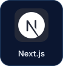
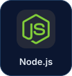
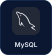

  

&nbsp;&nbsp;&nbsp;&nbsp;

 

Software engineer based in Mauritania, building full-stack products that people use on their phones — in Arabic, French and English. I take a feature from the database schema to the last pixel: Next.js and TypeScript in front, PostgreSQL with row-level security behind it. Recent work includes a national exam-results site that searches 121k records without a database, and a maths learning platform with signed video delivery.

 

<h2 align="center">Selected work</h2>

<table>
<tr>
<td>

**Mobile-first learning platform for Mauritania's secondary-school maths programme** — lesson videos with signed playback, a quiz after every lesson, chat with the teacher, and a full admin studio for content, students and payments.

`Next.js 16` `React 19` `TypeScript` `Supabase` `PostgreSQL` `Cloudflare Workers` `Bunny Stream`

Private repository · built with a team of three · pre-launch

</td>
</tr>
<tr>
<td>

### Natija
Mauritania's national exam results, searchable in the browser — 121k rows, no database, admin uploads the official Excel file.

`Next.js` `TypeScript` `Vercel Blob`

[**Code**](https://github.com/Git-moud1/natija) · [**Live demo**](https://natija-ten.vercel.app)

</td>
</tr>
<tr>
<td>

### Mauri-Dev
Trilingual portfolio and marketing site (AR / EN / FR) that turns visitors into clients, with an admin panel for the content.

`Next.js 16` `React 19` `Tailwind`

[**Live site**](https://mauri-dev.online)

</td>
</tr>
<tr>
<td>

### Skin Beauty
Korean skincare storefront for a local seller — bilingual AR/FR, prices in MRU, orders land in a dashboard with one-click WhatsApp.

`Next.js` `JavaScript` `Tailwind`

[**Code**](https://github.com/Git-moud1/skin-beauty) · [**Live demo**](https://skin-beauty-nine.vercel.app)

</td>
</tr>
</table>

 

<h2 align="center">Toolkit</h2>

<b>Languages</b>  

<b>Web and mobile</b>  

<b>Backend</b>  

<b>Databases</b>  

<b>Machine Learning</b>  

<b>Tools</b>  

 

<h2 align="center">Get in touch</h2>

The fastest way to reach me is <a href="mailto:baymed000@gmail.com"><b>baymed000@gmail.com</b></a>. 
Open to freelance work and collaboration on web products.

 

